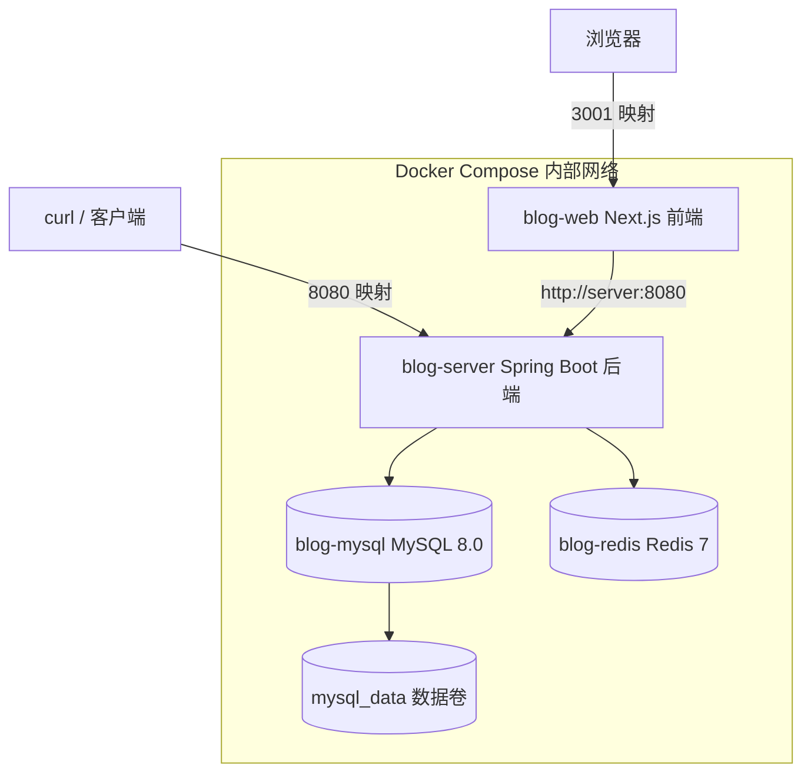
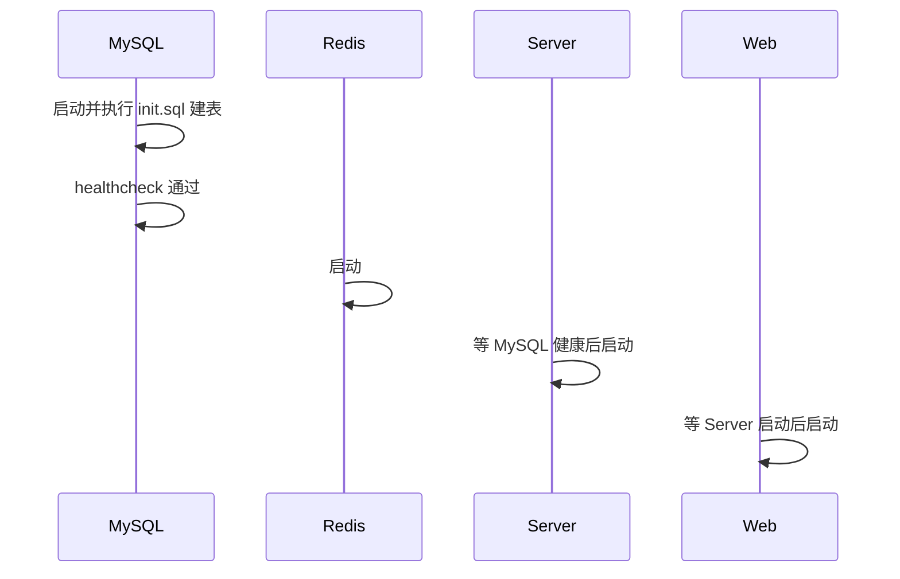

# Docker / Git 使用说明

本文档说明如何在 `bokeApp` 项目中使用 Git 和 Docker。

---

## 一、Git 使用

### 1. 初始化仓库

> 本项目已完成初始化并推送到远程仓库（`main` 分支）。以下命令供新环境参考：

```bash
git init
```

### 2. 配置用户信息（首次使用）

```bash
git config user.name  "你的名字"
git config user.email "your@email.com"
```

> 全局配置可加 `--global` 参数。

### 3. 首次提交

```bash
git add .
git commit -m "chore: 初始化项目文档与脚手架"
```

### 4. 关联远程仓库（可选）

```bash
git remote add origin https://github.com/你的用户名/bokeApp.git
git branch -M main
git push -u origin main
```

### 5. 日常开发工作流

```bash
# 查看状态
git status

# 查看改动
git diff

# 暂存并提交
git add <文件>
git commit -m "feat: 新增文章模块"

# 拉取远程更新
git pull

# 推送
git push
```

### 6. 分支管理建议

| 分支 | 用途 |
| --- | --- |
| `main` | 稳定可发布分支 |
| `develop` | 日常开发集成 |
| `feature/xxx` | 功能开发 |
| `fix/xxx` | 缺陷修复 |

```bash
# 创建并切换功能分支
git checkout -b feature/article-module

# 合并回开发分支
git checkout develop
git merge feature/article-module
```

### 7. 提交信息规范

采用 `type(scope): subject` 格式，type 常用：

- `feat` — 新功能
- `fix` — 修复缺陷
- `docs` — 文档
- `chore` — 构建 / 工具配置
- `refactor` — 重构

> 已提供 `.gitignore`，会忽略 `node_modules`、`.next`、`target` 等产物，无需手动处理。

---

## 二、Docker 使用

### 1. 前置条件

- 安装 [Docker Desktop](https://www.docker.com/products/docker-desktop/)（Windows / macOS）
- 确认 `docker` 与 `docker compose` 命令可用：

```bash
docker --version
docker compose version
```

### 2. 项目中的 Docker 文件

| 文件 | 说明 |
| --- | --- |
| `docker-compose.yml` | 编排 MySQL、Redis、后端、前端四个服务 |
| `web/Dockerfile` | Next.js 前端多阶段构建镜像 |
| `server/Dockerfile` | Spring Boot 后端多阶段构建镜像 |

### 3. 启动完整环境

在项目根目录执行：

```bash
docker compose up -d --build
```

启动后各服务端口：

| 服务 | 地址 | 说明 |
| --- | --- | --- |
| 前端 Web | http://localhost:3001 | Next.js |
| 后端 API | http://localhost:8080 | Spring Boot |
| MySQL | localhost:3306 | 账号 root / 密码 root |
| Redis | localhost:6379 | 无密码 |

### 4. 常用命令

```bash
# 查看运行状态
docker compose ps

# 查看日志
docker compose logs -f server
docker compose logs -f web

# 停止服务（保留数据卷）
docker compose down

# 停止并删除数据卷（会清空 MySQL 数据）
docker compose down -v

# 仅重建某个服务
docker compose up -d --build server
```

### 5. 数据持久化

- MySQL 数据存放在命名卷 `mysql_data` 中，`docker compose down` 不会删除数据。
- 如需彻底清空数据库，执行 `docker compose down -v`。

### 6. Docker 启动机制详解

#### 整体架构



#### 依赖的核心文件

| 文件 | 角色 | 作用 |
| --- | --- | --- |
| `docker-compose.yml` | 总指挥 | 定义 4 个服务、端口、依赖关系、环境变量 |
| `web/Dockerfile` | 前端配方 | 将 Next.js 打包成镜像 |
| `server/Dockerfile` | 后端配方 | 将 Spring Boot 打包成镜像 |
| `server/src/main/resources/db/init.sql` | 建表脚本 | MySQL 首次启动时自动建表 |
| `web/.dockerignore`、`server/.dockerignore` | 过滤 | 避免把 `node_modules`/`target` 复制进镜像 |

#### 依赖的基础镜像

| 镜像 | 用途 |
| --- | --- |
| `node:20-alpine` | 前端运行环境 |
| `maven:3.9-eclipse-temurin-17` | 后端**构建**环境（Maven + JDK 17） |
| `eclipse-temurin:17-jre` | 后端**运行**环境（JRE 17） |
| `mysql:8.0` | 数据库 |
| `redis:7-alpine` | 缓存 |

> 后端采用**两阶段构建**：先在 `maven` 镜像里编译打包，再把产物放进精简的 `jre` 镜像运行。

#### 启动顺序



- 依赖关系由 `depends_on` 控制：`server` 依赖 `mysql` 的健康状态 + `redis` 启动。
- MySQL 通过 `healthcheck`（`mysqladmin ping`）判断就绪，避免后端连不上库直接崩溃。

#### 网络通信

容器间用**服务名**互访（走内部网络），宿主机用**端口映射**访问：

| 通信 | 地址 | 说明 |
| --- | --- | --- |
| 前端 → 后端 | `http://server:8080` | 服务名，内部网络 |
| 后端 → MySQL | `jdbc:mysql://mysql:3306` | 服务名 |
| 后端 → Redis | `redis:6379` | 服务名 |
| 浏览器 → 前端 | `localhost:3001` | 映射到容器 3000 |
| 客户端 → 后端 | `localhost:8080` | 映射到容器 8080 |

#### 环境变量注入

容器内不写死配置，通过环境变量注入。例如后端：

```yaml
SPRING_DATASOURCE_URL: jdbc:mysql://mysql:3306/blog?useUnicode=true&characterEncoding=UTF-8&serverTimezone=Asia/Shanghai
SPRING_DATASOURCE_USERNAME: root
SPRING_DATASOURCE_PASSWORD: root
```

Spring Boot 自动读取 `SPRING_*` 环境变量并**覆盖** `application.yml` 的默认值——因此 Docker 环境用 `mysql:3306`（服务名），本地开发用 `localhost:3306`。

#### 代理配置（国内网络必需）

镜像拉取依赖 VPN 代理，已在 Docker Desktop 的 `daemon.json` 配置：

```json
{
  "proxies": {
    "default": {
      "httpProxy": "http://127.0.0.1:7897",
      "httpsProxy": "http://127.0.0.1:7897"
    }
  }
}
```

首次构建前，建议先用 `docker pull` 预拉取基础镜像，避免 buildkit 直连 Docker Hub 失败：

```bash
docker pull node:20-alpine
docker pull maven:3.9-eclipse-temurin-17
docker pull eclipse-temurin:17-jre
docker pull mysql:8.0
docker pull redis:7-alpine
```

---

## 三、本地开发运行（不依赖 Docker）

### 1. 启动 MySQL 与 Redis

本地需先准备好 MySQL 8.0 与 Redis 7，并执行建表脚本：

```bash
mysql -uroot -p < server/src/main/resources/db/init.sql
```

### 2. 启动后端

```bash
cd server
mvn spring-boot:run
```

后端启动后访问 http://localhost:8080/api/v1/health 验证。

### 3. 启动前端

```bash
cd web
npm install
npm run dev
```

前端启动后访问 http://localhost:3001。

> 前端通过 `NEXT_PUBLIC_API_BASE_URL` 指定后端地址，默认 `http://localhost:8080`，可复制 `.env.example` 为 `.env.local` 修改。

---

## 四、注意事项

- 后端构建需要 `pom.xml` 与 `src` 目录，前端构建需要 `package.json`，这些已就绪。
- 数据库连接、Redis 地址、JWT 密钥等配置在 `server/src/main/resources/application.yml` 中，部署时请修改默认密码与密钥。
- 首次执行 `docker compose up --build` 会自动通过挂载的 `init.sql` 初始化数据库表结构。
