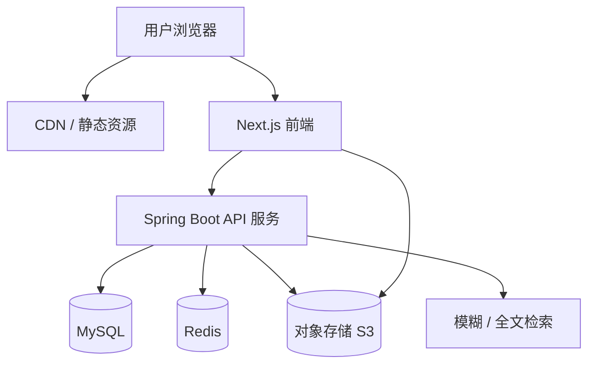
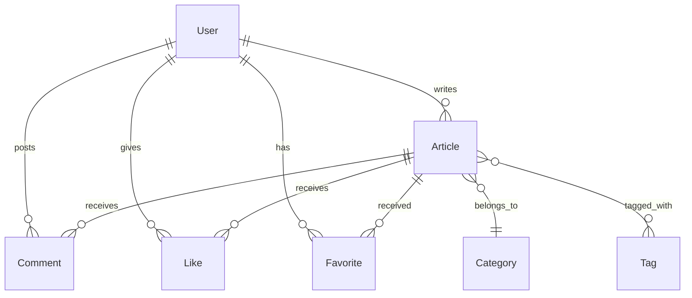
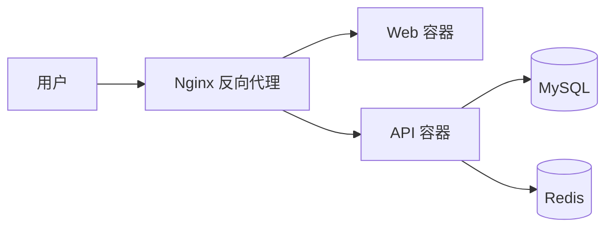

# 博客网站技术文档

> 版本：v1.1  
> 状态：草案  
> 更新日期：2026-11-01  
> 关联文档：《产品文档.md》

---

## 1. 技术选型

| 层级 | 技术 | 版本建议 | 说明 |
| --- | --- | --- | --- |
| 前端框架 | Next.js（React） | 14+ | SSR 利于 SEO，App Router |
| 前端语言 | JavaScript（ES2022） | - | 纯 JS 开发，无 TypeScript |
| UI 组件库 | Tailwind CSS + shadcn/ui | - | 快速构建、风格统一 |
| 状态管理 | React Query + Zustand | - | 服务端状态 + 客户端状态 |
| 富文本编辑 | TipTap / MDXEditor | - | Markdown / 富文本写作 |
| 后端框架 | Spring Boot | 3.x | Java 主流 Web 框架 |
| 后端语言 | Java | 17+ | LTS 版本 |
| ORM | MyBatis-Plus | 3.5+ | 简洁、灵活，国内主流 |
| 认证 / 安全 | Spring Security + JJWT | - | 鉴权 + JWT 令牌 |
| 数据库 | MySQL | 8.0+ | 主数据存储 |
| 缓存 | Redis | 7+ | 会话、热点缓存 |
| 对象存储 | S3 兼容（MinIO / OSS） | - | 图片与附件 |
| 搜索 | MySQL LIKE（MVP） | - | 初期模糊查询，后续 ES |
| 部署 | Docker + Docker Compose | - | 容器化编排 |

---

## 2. 系统架构



**架构要点：**

- 前后端分离，前端负责渲染与 SEO，后端提供 RESTful API。
- 图片 / 附件直传对象存储，后端签发上传凭证。
- 热点文章与页面缓存写入 Redis，降低数据库压力。
- MVP 阶段使用 MySQL 模糊查询（LIKE）实现搜索，数据量增长后再引入 Elasticsearch。

---

## 3. 项目结构

```
bokeApp/
├── web/                        # Next.js 前端（JavaScript）
│   ├── app/                    # 页面路由（App Router）
│   ├── components/             # UI 组件
│   ├── lib/                    # 工具函数、API 客户端
│   └── public/                 # 静态资源
├── server/                     # Spring Boot 后端（Java）
│   ├── src/main/java/com/boke/
│   │   ├── BokeApplication.java
│   │   ├── config/             # 配置类（Security、Redis 等）
│   │   ├── controller/         # 控制器层
│   │   ├── service/            # 业务逻辑层
│   │   ├── mapper/             # MyBatis-Plus 数据访问层
│   │   ├── entity/             # 实体类
│   │   ├── dto/                # 数据传输对象
│   │   ├── common/             # 通用响应、异常处理、工具类
│   │   └── security/           # JWT 过滤器、认证逻辑
│   ├── src/main/resources/
│   │   ├── application.yml     # 配置文件
│   │   └── mapper/             # XML 映射文件（如需要）
│   └── pom.xml                 # Maven 依赖
├── docker/                     # Docker 配置
├── docker-compose.yml
└── README.md
```

---

## 4. 数据库设计

### 4.1 实体关系



### 4.2 核心表结构

**users（用户表）**

| 字段 | 类型 | 说明 |
| --- | --- | --- |
| id | BIGINT | 主键，自增 |
| email | VARCHAR(100) | 唯一，登录邮箱 |
| password_hash | VARCHAR(255) | 密码哈希 |
| nickname | VARCHAR(50) | 昵称 |
| avatar_url | VARCHAR(255) | 头像地址 |
| bio | TEXT | 个人简介 |
| role | VARCHAR(20) | user / admin |
| status | VARCHAR(20) | active / banned |
| created_at | DATETIME | 创建时间 |

**articles（文章表）**

| 字段 | 类型 | 说明 |
| --- | --- | --- |
| id | BIGINT | 主键，自增 |
| author_id | BIGINT | 外键 → users |
| category_id | BIGINT | 外键 → categories |
| title | VARCHAR(200) | 标题 |
| slug | VARCHAR(200) | 唯一，URL 标识 |
| summary | VARCHAR(500) | 摘要 |
| content | LONGTEXT | 正文（Markdown） |
| cover_url | VARCHAR(255) | 封面图 |
| status | VARCHAR(20) | draft / published / hidden |
| is_pinned | TINYINT(1) | 是否置顶 |
| view_count | INT | 阅读量 |
| like_count | INT | 点赞数 |
| published_at | DATETIME | 发布时间 |
| created_at | DATETIME | 创建时间 |
| updated_at | DATETIME | 更新时间 |

**categories（分类表）**

| 字段 | 类型 | 说明 |
| --- | --- | --- |
| id | BIGINT | 主键，自增 |
| name | VARCHAR(50) | 分类名 |
| slug | VARCHAR(100) | 唯一 |
| parent_id | BIGINT | 父分类（可空） |

**tags（标签表）**

| 字段 | 类型 | 说明 |
| --- | --- | --- |
| id | BIGINT | 主键，自增 |
| name | VARCHAR(50) | 标签名 |
| slug | VARCHAR(100) | 唯一 |

**article_tags（文章-标签关联表）**

| 字段 | 类型 | 说明 |
| --- | --- | --- |
| article_id | BIGINT | 外键 → articles |
| tag_id | BIGINT | 外键 → tags |

**comments（评论表）**

| 字段 | 类型 | 说明 |
| --- | --- | --- |
| id | BIGINT | 主键，自增 |
| article_id | BIGINT | 外键 → articles |
| user_id | BIGINT | 外键 → users |
| parent_id | BIGINT | 父评论（楼中楼，可空） |
| content | TEXT | 评论内容 |
| created_at | DATETIME | 创建时间 |

**likes（点赞表）**

| 字段 | 类型 | 说明 |
| --- | --- | --- |
| id | BIGINT | 主键，自增 |
| user_id | BIGINT | 外键 → users |
| article_id | BIGINT | 外键 → articles |
| created_at | DATETIME | 创建时间 |

**favorites（收藏表）**

| 字段 | 类型 | 说明 |
| --- | --- | --- |
| id | BIGINT | 主键，自增 |
| user_id | BIGINT | 外键 → users |
| article_id | BIGINT | 外键 → articles |
| created_at | DATETIME | 创建时间 |

> 点赞与收藏表建议对 `(user_id, article_id)` 建立唯一索引，防止重复操作。所有表统一使用 InnoDB 引擎、`utf8mb4` 字符集。

---

## 5. API 设计

### 5.1 通用约定

- 基础路径：`/api/v1`
- 请求 / 响应：JSON
- 认证方式：`Authorization: Bearer <access_token>`
- 统一响应结构：

```json
{
  "code": 0,
  "message": "success",
  "data": {}
}
```

### 5.2 接口列表（节选）

| 方法 | 路径 | 说明 | 认证 |
| --- | --- | --- | --- |
| POST | `/auth/register` | 注册 | 否 |
| POST | `/auth/login` | 登录 | 否 |
| POST | `/auth/refresh` | 刷新令牌 | 否 |
| GET | `/articles` | 文章列表（分页 / 筛选） | 否 |
| GET | `/articles/:slug` | 文章详情 | 否 |
| POST | `/articles` | 发布文章 | 是 |
| PUT | `/articles/:id` | 更新文章 | 是（作者） |
| DELETE | `/articles/:id` | 删除文章 | 是（作者） |
| GET | `/categories` | 分类列表 | 否 |
| GET | `/tags` | 标签列表 | 否 |
| GET | `/comments?articleId=` | 评论列表 | 否 |
| POST | `/comments` | 发表评论 | 是 |
| POST | `/articles/:id/like` | 点赞 / 取消 | 是 |
| POST | `/articles/:id/favorite` | 收藏 / 取消 | 是 |
| POST | `/upload` | 图片上传 | 是 |
| GET | `/admin/stats` | 数据统计 | 是（admin） |

### 5.3 错误码

| code | 含义 |
| --- | --- |
| 0 | 成功 |
| 1001 | 参数错误 |
| 1002 | 未认证 / 令牌失效 |
| 1003 | 无权限 |
| 2001 | 资源不存在 |
| 2002 | 资源冲突（如邮箱已注册） |
| 5000 | 服务器内部错误 |

---

## 6. 核心模块设计

### 6.1 认证模块

- 登录成功后签发 **Access Token**（短期，如 15 分钟）与 **Refresh Token**（长期，如 7 天）。
- Access Token 用于接口鉴权，Refresh Token 用于无感续期。
- 密码使用 `BCryptPasswordEncoder` 加盐哈希存储。
- Refresh Token 存入 Redis，支持主动注销。
- 通过 Spring Security 过滤器链校验 JWT，使用 `OncePerRequestFilter` 解析并注入 `SecurityContext`。

### 6.2 文章模块

- 使用 `slug` 作为公开 URL，标题变更时保持 slug 稳定。
- 文章内容以 Markdown 存储，前端渲染。
- 支持 `draft / published / hidden` 三种状态。
- 列表接口支持按分类、标签、关键词、排序（最新 / 最热）筛选。
- 使用 MyBatis-Plus 分页插件实现分页查询。

### 6.3 文件上传

- 后端签发临时上传凭证，前端直传对象存储。
- 限制文件类型与大小（如图片 ≤ 5MB）。
- 存储路径：`/{user_id}/{date}/{uuid}.{ext}`。

### 6.4 搜索

- MVP 使用 MySQL `LIKE` 对标题、摘要进行模糊查询，必要时对 `title`、`summary` 建立前缀索引。
- 数据量增长后迁移到 Elasticsearch。

---

## 7. 安全设计

| 威胁 | 防护措施 |
| --- | --- |
| SQL 注入 | MyBatis 参数绑定（`#{}`），避免字符串拼接 |
| XSS | 前端渲染转义、Markdown 白名单过滤 |
| CSRF | 使用 JWT Bearer 认证，非 Cookie 会话 |
| 密码泄露 | BCrypt 哈希 + 登录限流 |
| 越权访问 | 资源级权限校验（作者 / 管理员） |
| 接口滥用 | 登录与评论接口限流（Redis 计数） |

---

## 8. 部署方案



**部署步骤（Docker Compose）：**

1. 构建镜像：`docker compose build`
2. 初始化数据库：执行 `server/src/main/resources/db/migration` 下的 SQL 脚本
3. 启动服务：`docker compose up -d`
4. 配置环境变量（MySQL 连接、JWT 密钥、对象存储凭证）

---

## 9. 环境变量

```yaml
# server/src/main/resources/application.yml
spring:
  datasource:
    url: jdbc:mysql://localhost:3306/blog?useUnicode=true&characterEncoding=utf8mb4&serverTimezone=Asia/Shanghai
    username: root
    password: your_password
  data:
    redis:
      host: localhost
      port: 6379

# 认证
jwt:
  access-secret: xxx
  refresh-secret: xxx
  access-expiration: 900000       # 15 分钟（毫秒）
  refresh-expiration: 604800000   # 7 天（毫秒）

# 对象存储
oss:
  endpoint: xxx
  access-key: xxx
  secret-key: xxx
  bucket: blog-images
```

---

## 10. 后续演进

- 引入 Elasticsearch 增强全文搜索
- 支持第三方登录（OAuth2）
- 多语言（i18n）
- 评论审核与敏感词过滤
- 监控告警（Prometheus + Grafana）

---

> 本文档与技术选型可随开发推进持续调整，欢迎补充具体需求。
